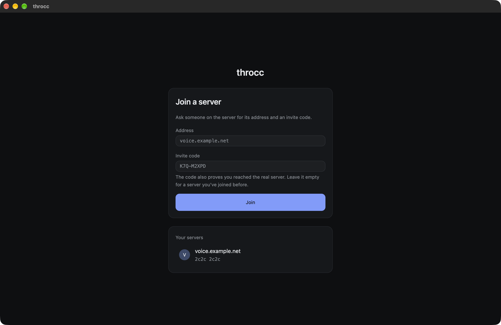
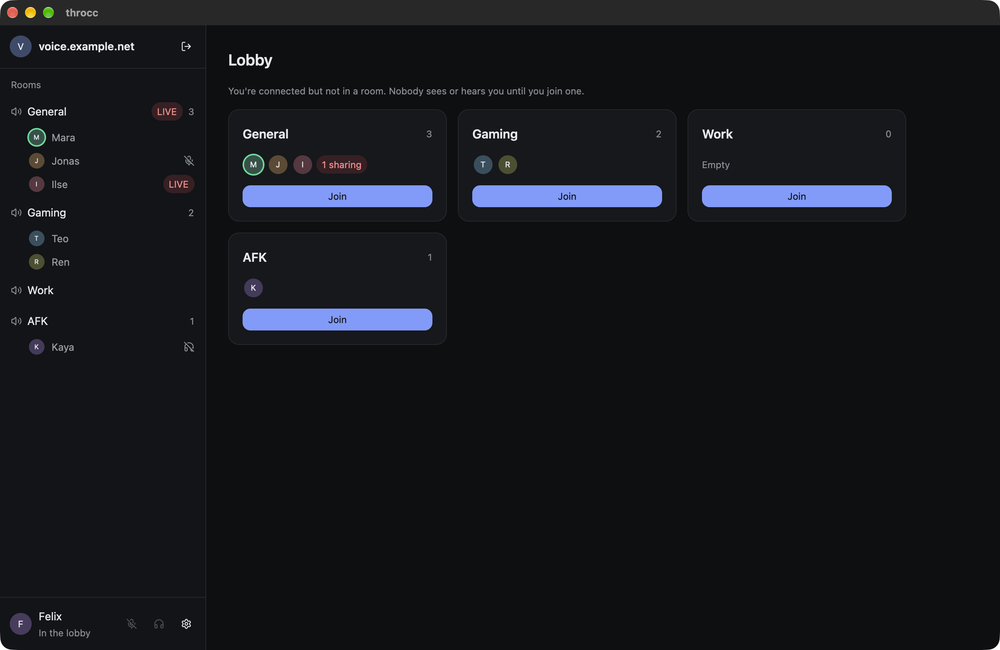
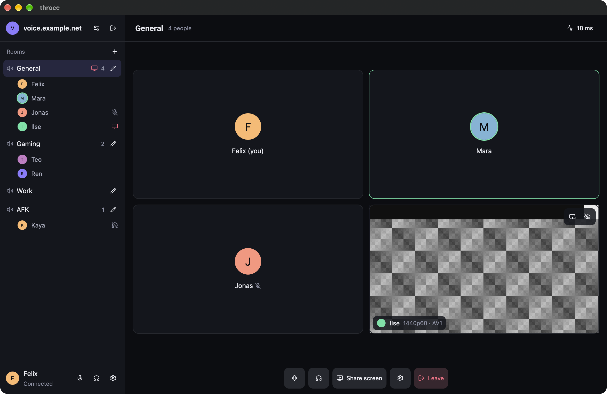
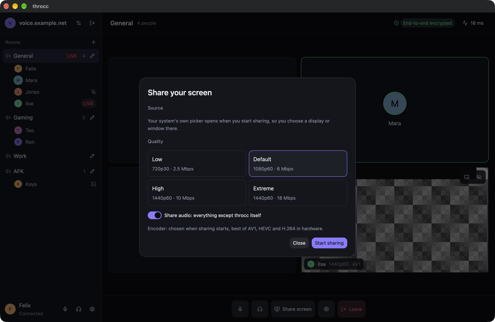
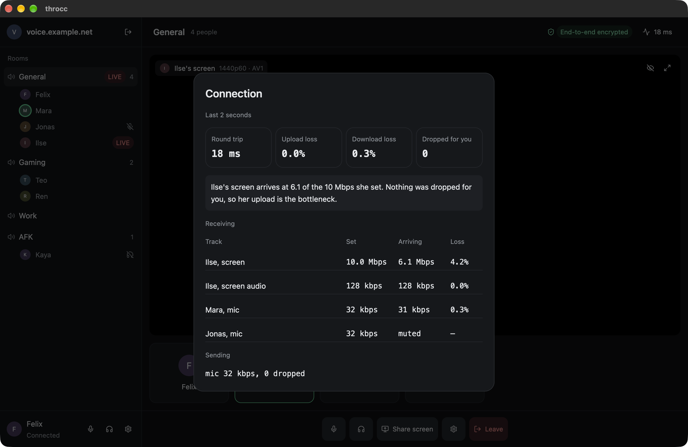
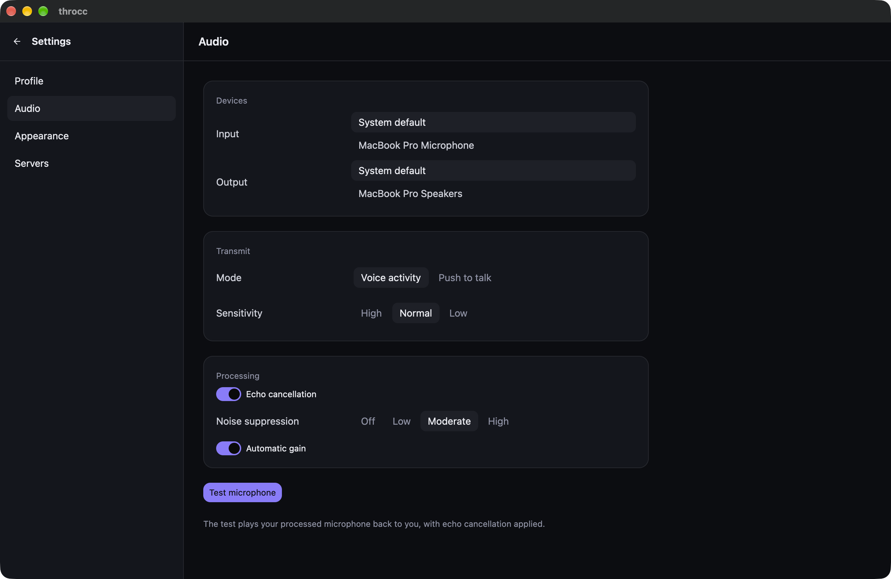
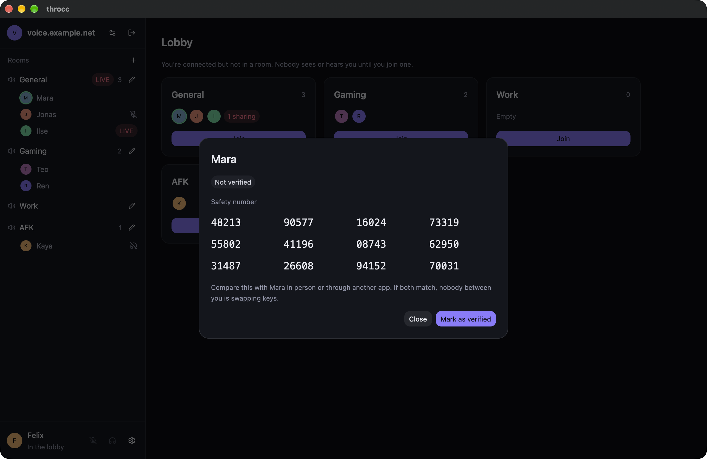
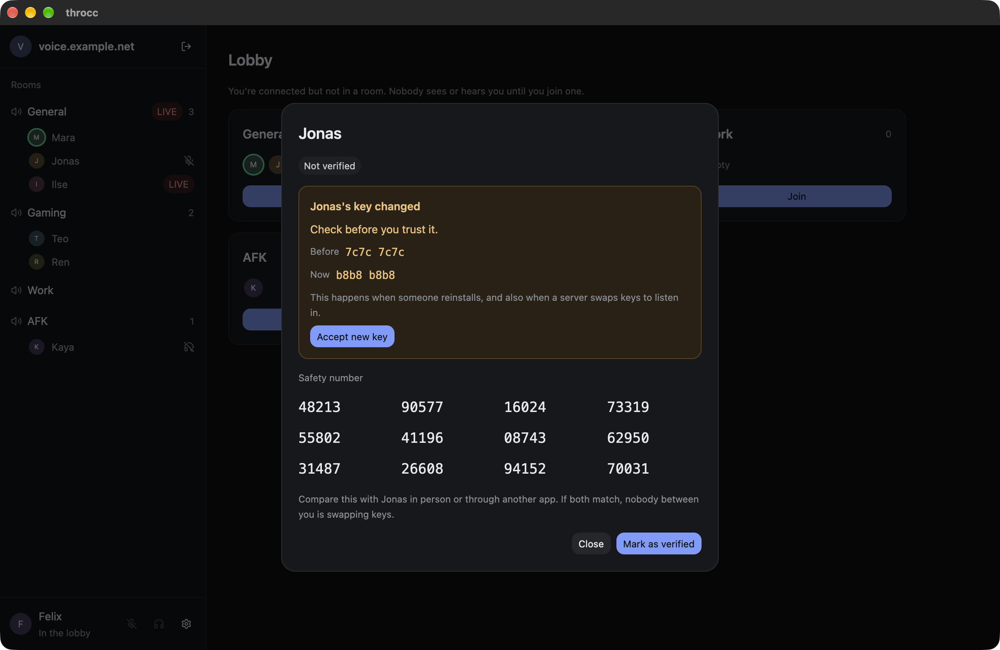
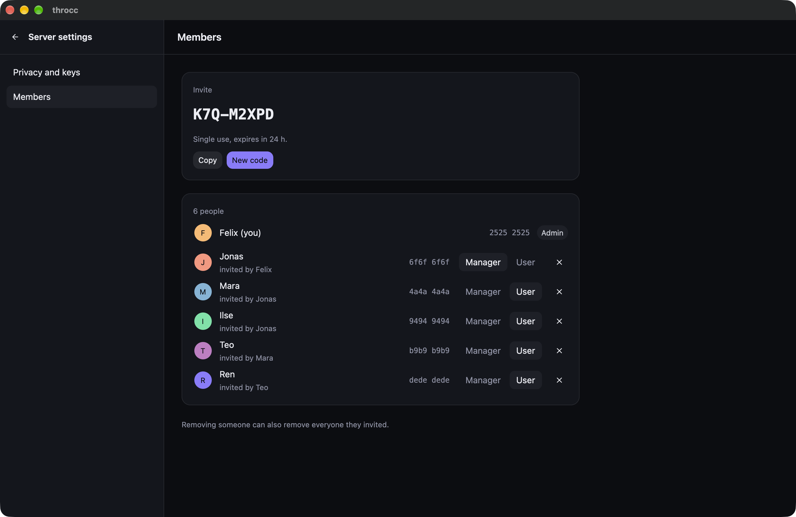

# throcc

Self-hosted voice and screen share in Rust, end-to-end encrypted.

## Run a server

The server is one static binary that keeps all its state in one data directory. It listens on UDP 8476 (QUIC); there is no TCP port.

### On Debian or any systemd Linux

Build the static binary for your machine (`aarch64-unknown-linux-musl` on ARM), or download it from the `server-binaries` job of a CI run:

```sh
docker build -f tests/deploy/Dockerfile.static --build-arg TARGET=x86_64-unknown-linux-musl -t throcc-static .
docker create --name copy throcc-static && docker cp copy:/throcc-server . && docker rm copy
```

Install it with the unit from `packaging/`:

```sh
sudo install -m 0755 throcc-server /usr/local/bin/
sudo install -m 0644 packaging/throcc-server.service /etc/systemd/system/
sudo systemctl enable --now throcc-server
journalctl -u throcc-server | grep 'becomes admin'
```

The unit runs the server as a throwaway system user with its data in `/var/lib/private/throcc`.

### In a container

Every push to `main` publishes `ghcr.io/nylyk/throcc:latest` for amd64 and arm64 (and `:<version>` for tags):

```sh
docker run -d --name throcc --restart unless-stopped -p 8476:8476/udp -v throcc-data:/data ghcr.io/nylyk/throcc:latest
docker logs throcc | grep 'becomes admin'
```

To build it yourself instead: `docker build -f crates/throcc-server/Dockerfile -t throcc-server .`

For development, the `dev` stage rebuilds and restarts the server on every change to the source mounted at `/src`:

```sh
docker build -f crates/throcc-server/Dockerfile --target dev -t throcc-server-dev .
docker run --rm -p 8476:8476/udp --mount type=bind,src="$PWD",dst=/src,readonly throcc-server-dev
```

### Open the port

Allow UDP 8476 in the firewall and forward it on the router if the server is behind NAT. Clients only need outbound UDP.

### Join

On first start the server logs one invite code and its fingerprint. Whoever joins with that code becomes the admin. Start the desktop client, enter the server's address and the code, and check that the fingerprint it shows matches the server's log. Admins and managers make more invites from the Members screen; each code works once and expires.

### Back up

The data directory is the only state: `server_key` (the server's identity) and the SQLite database. Stop the server and copy the directory, or copy it while it runs with `sqlite3 throcc.sqlite '.backup copy.sqlite'` plus `server_key`. Losing `server_key` means every client sees a different server and has to rejoin.

## Build the client

```sh
cargo build --release -p throcc-client --features ffmpeg
```

Screen sharing needs ffmpeg 8 (`--features ffmpeg`); without it the client still does voice.

- macOS: Xcode 26 or its Command Line Tools, and `brew install ffmpeg@8` with `FFMPEG_PKG_CONFIG_PATH=/opt/homebrew/opt/ffmpeg@8/lib/pkgconfig`.
- Linux: the packages in `.github/workflows/ci.yml`, plus ffmpeg 8 development files. With clang 21 or newer, generate the ffmpeg bindings with `packaging/ffmpeg/bindings.sh <ffmpeg prefix> binding.rs` (needs `bindgen` 0.72) and build with `FFMPEG_DLL_PATH=<prefix>/lib FFMPEG_BINDING_PATH=binding.rs`.
- Windows: ffmpeg 8 development files found through `FFMPEG_PKG_CONFIG_PATH` or vcpkg.

`throcc-cli` is a headless client for scripts and testing (`throcc-cli --help`).

### Packages

`packaging/ffmpeg/build.sh <prefix>` builds the LGPL ffmpeg the packages ship with.

- macOS: `packaging/macos/bundle.sh` makes `target/macos/throcc.dmg` (needs `brew install dav1d libvpx pkgconf`). It isn't signed with a Developer ID yet, so open it the first time with right-click, Open.
- Arch: every push to `main` publishes a package to the `nightly` release. Install or update with `curl -LO https://github.com/nylyk/throcc/releases/download/nightly/throcc-x86_64.pkg.tar.zst && sudo pacman -U throcc-x86_64.pkg.tar.zst`. To build it yourself, `packaging/arch/PKGBUILD` builds from git with a private LGPL ffmpeg in `/usr/lib/throcc` (`makepkg -si` in that directory). Running `makepkg -si` again in the same directory reuses the ffmpeg build and Cargo's `target/`, so only changed crates recompile. `tests/arch/run.sh` builds and installs it in a clean Arch container.
- Windows: from a Visual Studio developer prompt with nasm on `PATH`, `packaging/windows/build-deps.sh` (in Git Bash) builds dav1d; then, in an MSYS2 shell that inherits that environment, `packaging/ffmpeg/build.sh deps/ffmpeg-lgpl` and `packaging/ffmpeg/bindings.sh deps/ffmpeg-lgpl deps/ffmpeg-lgpl/binding.rs`; then `packaging\windows\package.ps1` makes `target\windows\throcc-windows.zip`. The `windows-app` job in `.github/workflows/packaging.yml` shows the exact steps.
- The `packaging` workflow builds the `.dmg`, the Windows zip and the static servers on tags, when packaging files change, weekly, or by hand, and keeps the files for a week. The `nightly` workflow builds, checks and publishes the Arch package.

## Screenshots

The desktop client, shown with sample data (`throcc-client --mock`). Regenerate them with `scripts/screens.sh`.

| | |
| --- | --- |
|  |  |
|  |  |
|  |  |
|  |  |
|  | |
