# throcc

Self-hosted voice and screen share, end-to-end encrypted. Written in Rust.

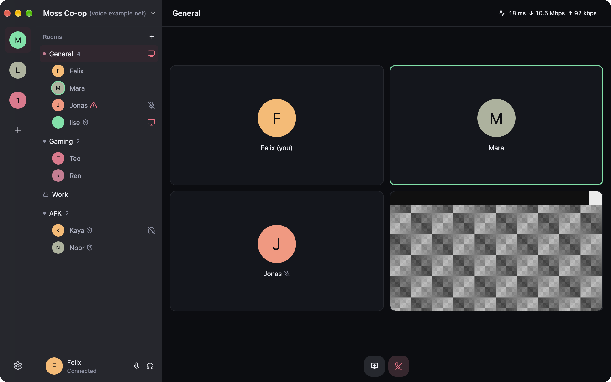

- Persistent rooms with low-latency voice, push-to-talk or voice activation, echo cancellation and noise suppression.
- Screen share up to 1440p60 with its system audio, encoded in hardware as AV1, HEVC or H.264, or as VP9 in software.
- Viewers choose which shares to watch, so nobody pays bandwidth for a share they don't watch.
- All media is end-to-end encrypted. The server relays it but holds no key.
- One server binary and one data directory. Joining takes an address and an invite code.
- Roles, invites and password-protected rooms. Themes you can edit.

## Run a server

The server listens on UDP 8476 (QUIC). There is no TCP port.

### With Docker

Every push to `main` publishes `ghcr.io/nylyk/throcc:latest` for amd64 and arm64, and tags publish `:<version>`.

```sh
docker run -d --name throcc --restart unless-stopped -p 8476:8476/udp -v throcc-data:/data ghcr.io/nylyk/throcc:latest
docker logs throcc | grep 'becomes admin'
```

### With Nix

`nix run github:nylyk/throcc#server`

### Then

1. Allow UDP 8476 in the firewall, and forward it if the server is behind NAT. Clients only need outbound UDP.
2. On first start the server logs an invite code and its fingerprint. Whoever joins with that code becomes the admin.
3. Anyone can make more invites from Server Settings: admins without limit, everyone else 3 a day. Each code works once and expires after a day.

**Back up** the data directory: `server_key` and the SQLite database. Stop the server and copy it, or run `sqlite3 throcc.sqlite '.backup copy.sqlite'` and copy `server_key`. Losing `server_key` gives the server a new identity, and every client has to rejoin.

## Get the client

- **Arch:** every push to `main` publishes a package to the `nightly` release.

  ```sh
  curl -LO https://github.com/nylyk/throcc/releases/download/nightly/throcc-x86_64.pkg.tar.zst && sudo pacman -U throcc-x86_64.pkg.tar.zst
  ```

- **Nix:** `nix run github:nylyk/throcc`. On macOS this needs the Xcode Command Line Tools.
- **macOS and Windows:** the `packaging` workflow builds a `.dmg` and a zip on tags and weekly, and keeps them for a week. The `.dmg` is not signed with a Developer ID, so open it the first time with right-click, Open.

Start the client, enter the server's address and an invite code, and check that the fingerprint it shows matches the server's log.

## Build from source

```sh
cargo build --release -p throcc-client --features ffmpeg
```

Screen share needs ffmpeg 8 (`--features ffmpeg`). Without it the client still does voice.

- **macOS:** Xcode 26 or its Command Line Tools, and `brew install ffmpeg@8` with `FFMPEG_PKG_CONFIG_PATH=/opt/homebrew/opt/ffmpeg@8/lib/pkgconfig`.
- **Linux:** the packages in `.github/workflows/ci.yml`, plus ffmpeg 8 development files. With clang 21 or newer, generate the bindings with `packaging/ffmpeg/bindings.sh <ffmpeg prefix> binding.rs` (needs `bindgen` 0.72) and build with `FFMPEG_DLL_PATH=<prefix>/lib FFMPEG_BINDING_PATH=binding.rs`.
- **Windows:** ffmpeg 8 development files found through `FFMPEG_PKG_CONFIG_PATH` or vcpkg.

The packages ship an LGPL ffmpeg built by `packaging/ffmpeg/build.sh <prefix>`.

- **macOS:** `packaging/macos/bundle.sh` makes `target/macos/throcc.dmg` (needs `brew install dav1d libvpx pkgconf`).
- **Arch:** `makepkg -si` in `packaging/arch/`. Running it again reuses the ffmpeg build and Cargo's `target/`.
- **Windows:** follow the `windows-app` job in `.github/workflows/packaging.yml`.

`throcc-cli` is a headless client for scripts and testing (`throcc-cli --help`).

## Security

Every member of a room wraps a fresh key to each other member whenever someone joins or leaves, so a newcomer can't decrypt what came before and a leaver can't decrypt what comes after. The client pins the server's key and each member's key, warns when one changes or when someone new takes the name of a person it knows, and shows a safety number to compare out of band.

The server still sees metadata: who is in which room, when, and at what bitrate. Profiles, avatars and room names are not end-to-end encrypted.

## Screenshots

Taken from the client's sample data (`throcc-client --mock`) with `scripts/screens.sh`.

| | |
| --- | --- |
| 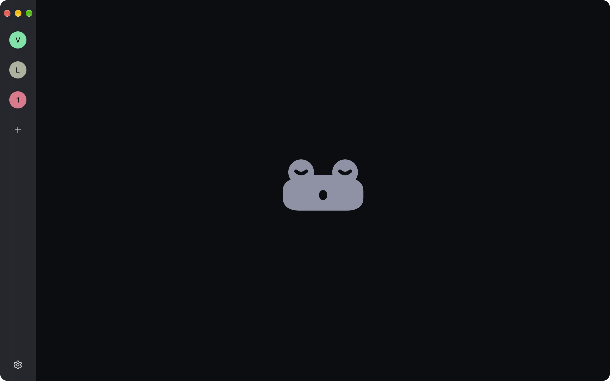 | 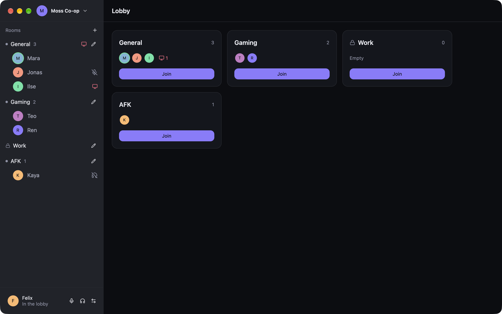 |
| 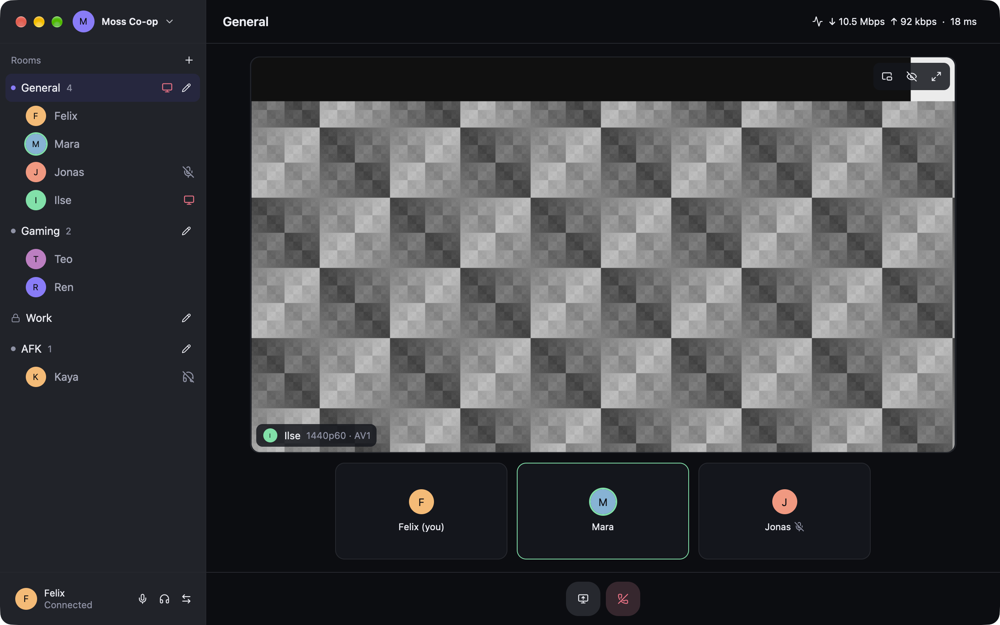 | 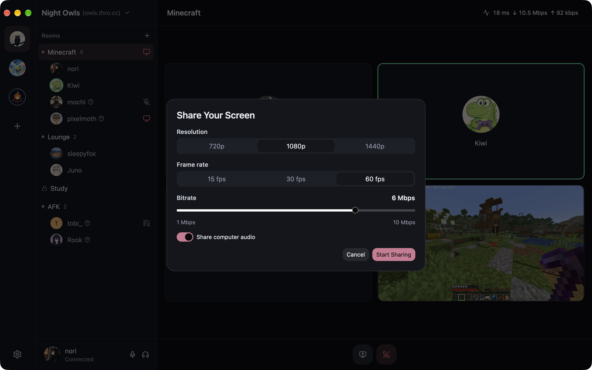 |
| 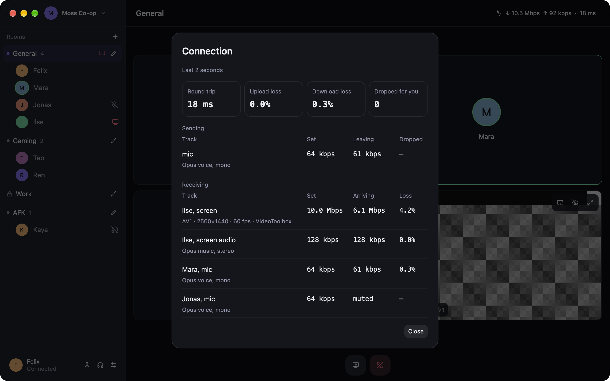 | 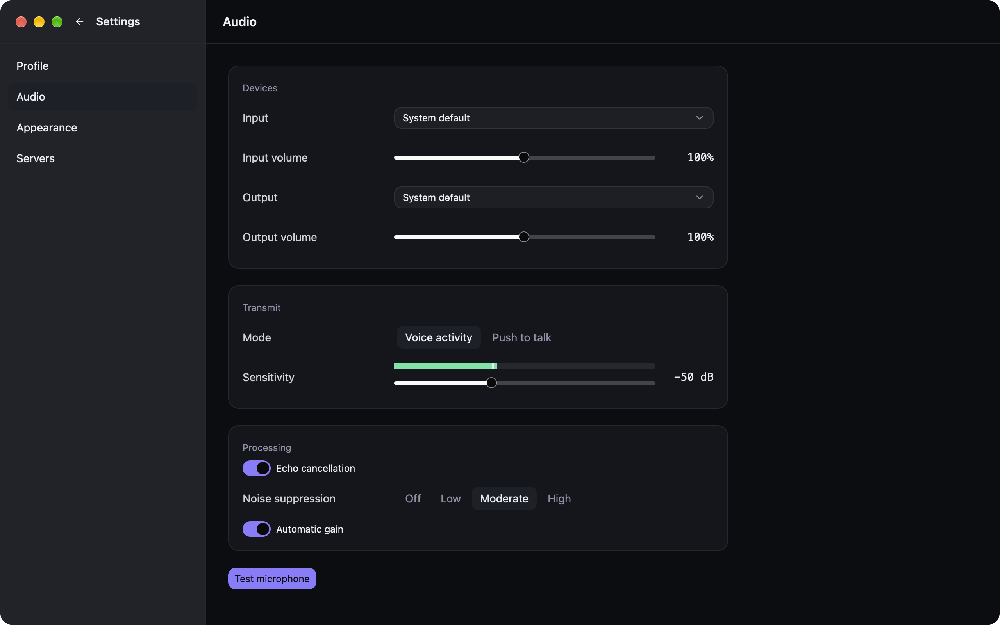 |
| 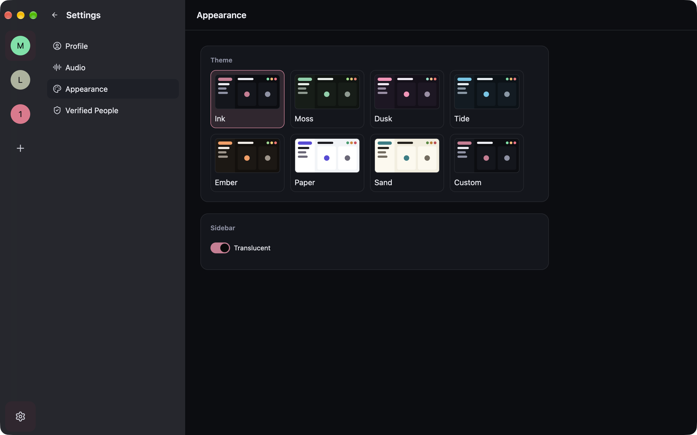 | 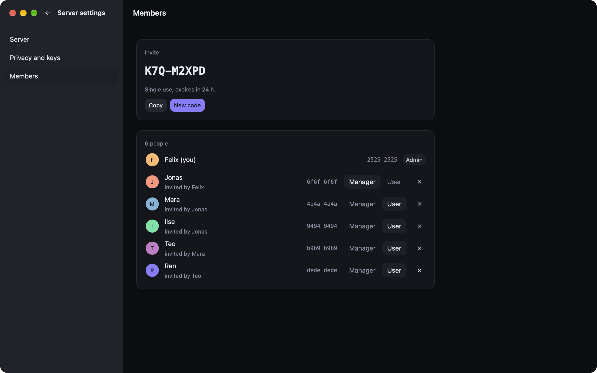 |
| 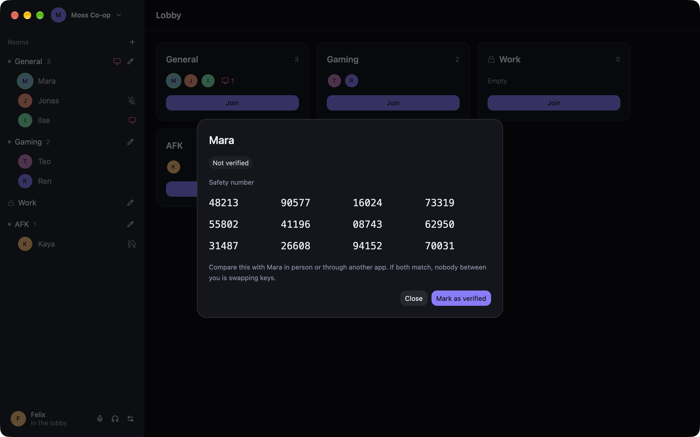 | 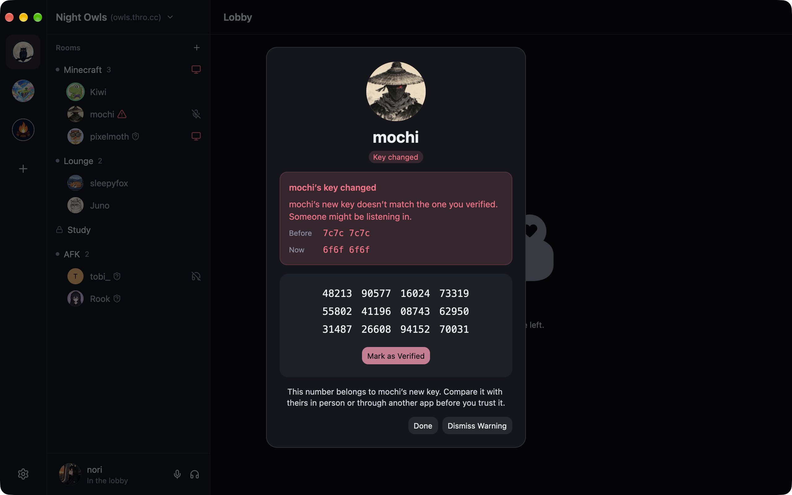 |
