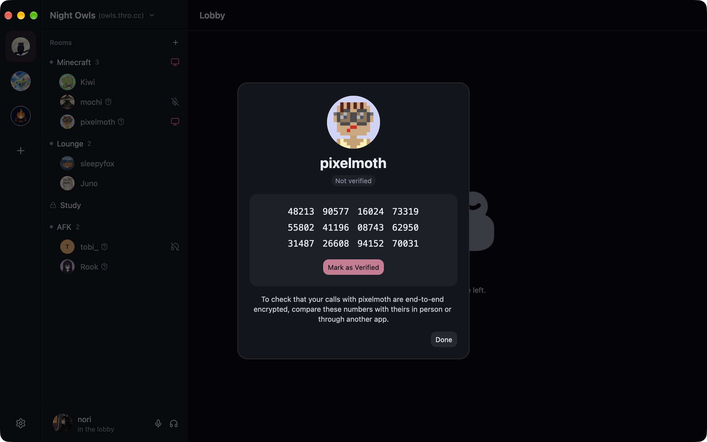

# throcc

Self-hosted voice and screen share, end-to-end encrypted. Written in Rust.


- Persistent rooms of up to 30 people with low-latency voice, push-to-talk or voice activation, echo cancellation and noise suppression.
- Screen share up to 1440p60 with its system audio, five at a time in a room, encoded in hardware as AV1, HEVC or H.264, or as VP9 in software.
- Viewers choose which shares to watch, so nobody pays bandwidth for a share they don't watch.
- All media is end-to-end encrypted. The server relays it but holds no key.
- One server binary and one data directory. Joining takes an address and an invite code.
- Roles, invites and password-protected rooms. Themes you can edit.

## Run a server

The server listens on UDP 8476 (QUIC). There is no TCP port.

### With Docker

Docker is the supported way to run a server. Each server release publishes `ghcr.io/nylyk/throcc` for amd64 and arm64 as `:<version>`, `:<major>.<minor>` and `:latest`. Pin the minor version: a new one may need newer clients.

```sh
docker run -d --name throcc --restart unless-stopped -p 8476:8476/udp -v throcc-data:/data ghcr.io/nylyk/throcc:0.1
docker exec throcc /throcc-server admin-invite --data /data
```

### With Nix

`nix run github:nylyk/throcc#server`

### Then

1. Allow UDP 8476 in the firewall, and forward it if the server is behind NAT. Clients only need outbound UDP.
2. Once the server is running, `throcc-server admin-invite --data <data directory>` prints an invite code, its expiry and the server's fingerprint. Whoever joins with that code becomes an admin, or is promoted to one if they are already a member. Run it again whenever you need one, for instance after losing your identity or admin role. Run it as the user the server runs as; in Docker, plain `docker exec throcc /throcc-server admin-invite --data /data` already does.
3. Anyone can make more invites from Server Settings: admins without limit, everyone else 3 a day. Each code works once and expires after a day. An account nobody signs in to for a year is removed, unless it is an admin's; whoever it invited stays.

**Back up** the data directory: `server_key` and the SQLite database. Stop the server and copy it, or run `sqlite3 throcc.sqlite '.backup copy.sqlite'` and copy `server_key`. Losing `server_key` gives the server a new identity, and every client has to rejoin.

## Get the client

Download it from the [releases page](https://github.com/nylyk/throcc/releases), where client releases are tagged `client-v<version>`. Each release lists the SHA-256 of its files in `SHA256SUMS`.

- **macOS 14 or newer:** `throcc.dmg`, signed with a Developer ID and notarized.
- **Windows:** `throcc-windows.zip`. Unzip it and run `throcc.exe`.
- **Linux:** `throcc.flatpak`. Install it with `flatpak install --user throcc.flatpak`; its runtime comes from Flathub.
- **Nix:** `nix run github:nylyk/throcc`. On macOS this needs the Xcode Command Line Tools.

Outside the flatpak, the client checks GitHub for a newer release when it starts. Turn that off in Settings, About.

A client works with any server that speaks its protocol version. If they differ, the client says which side needs an update.

Start the client, enter the server's address and an invite code, and check that the fingerprint it shows matches the one `admin-invite` printed or the server logged.

## Build from source

```sh
cargo build --release -p throcc-client --features ffmpeg
```

Screen share needs ffmpeg 8 (`--features ffmpeg`). Without it the client still does voice.

- **macOS:** Xcode 26 or its Command Line Tools, and `brew install ffmpeg@8` with `FFMPEG_PKG_CONFIG_PATH=/opt/homebrew/opt/ffmpeg@8/lib/pkgconfig`. To build against the LGPL ffmpeg the packages ship, run `packaging/ffmpeg/build.sh deps/ffmpeg-lgpl` and use `FFMPEG_PKG_CONFIG_PATH=$PWD/deps/ffmpeg-lgpl/lib/pkgconfig`.
- **Linux:** the packages in `.github/workflows/ci.yml`, plus ffmpeg 8 development files. With clang 21 or newer, generate the bindings with `packaging/ffmpeg/bindings.sh <ffmpeg prefix> binding.rs` (needs `bindgen` 0.72) and build with `FFMPEG_DLL_PATH=<prefix>/lib FFMPEG_BINDING_PATH=binding.rs`.
- **Windows:** ffmpeg 8 development files found through `FFMPEG_PKG_CONFIG_PATH` or vcpkg.

The packages ship an LGPL ffmpeg built by `packaging/ffmpeg/build.sh <prefix>`.

- **macOS:** `packaging/macos/bundle.sh` makes `target/macos/throcc.dmg` (needs `brew install dav1d libvpx pkgconf`). It signs ad hoc unless `MACOS_SIGN_IDENTITY` names a Developer ID Application identity, and notarizes with `NOTARY_KEY_FILE`, `NOTARY_KEY_ID` and `NOTARY_ISSUER`.
- **Flatpak:** `packaging/flatpak/cargo-sources.sh`, then `flatpak-builder --user --install-deps-from=flathub --install build packaging/flatpak/cc.thro.throcc.yml`.
- **Windows:** follow the `windows-app` job in `.github/workflows/packaging.yml`.

`throcc-cli` is a headless client for scripts and testing (`throcc-cli --help`).

## Security

Every member of a room wraps a fresh key to each other member whenever someone joins or leaves, or renews their encryption key, so a newcomer can't decrypt what came before and a leaver can't decrypt what comes after. The client pins the server's key. Each install has one identity key, used on every server, and the safety number between two people depends only on their two identity keys. Compare it out of band and mark the person verified once: they then show as verified on every server where that key appears, once they present it in a room with you, and from then on for the rest of that connection, even after they leave the room. Everyone not verified is marked so but still hears you: until you compare safety numbers, their key could be one the server made up. If a server shows a different key for someone you verified, the client warns that their key changed, and keeps warning, across restarts, until you verify the new key, dismiss the warning or mark the old key not verified. It also remembers, across restarts, the newest key epoch it took part in per room, and enrolls with a new encryption key each time, so a server can't replay an older call's keys.

The server still sees metadata: who is in which room, when, and at what bitrate. Profiles, avatars and room names are not end-to-end encrypted.

## Screenshots

Taken from the client's sample data (`throcc-client --mock`) with `scripts/screens.sh`.

| | |
| --- | --- |
|  |  |
|  |  |
|  |  |
|  |  |
|  |  |
